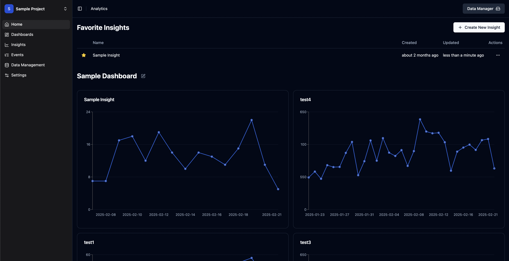
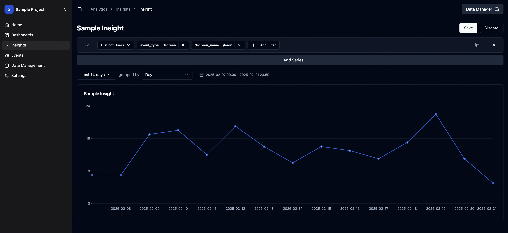

import { Aside, Card, CardGrid, LinkCard, Steps } from "@astrojs/starlight/components";

<Aside type="tip" title="In a hurry?">
    Skip ahead to the [Local Setup](/start-here/local/) and get a local instance running in a couple of minutes.
</Aside>

_Quacklytics_ is an open-source, self-hosted analytics service. It runs analytical queries in your browser with **DuckDB**,
so you don't pay for server-side compute.

## Why does this exist?

I built Quacklytics to **save costs** while still having a powerful and fast analytics stack for my products.

- **Easy to self-host.** One application container and one S3-compatible bucket.
- **Low maintenance.** No database cluster to tune and no data pipelines to manage.
- **Simple to use.** Send events to the ingestion endpoint and start building charts.

## How it works

Modern laptops and phones have capable CPUs and plenty of memory, and broadband is fast. Quacklytics downloads the data and runs the
heavy queries on the client instead of on the server.

<Steps>

1. **Ingest.** Your app sends events to `POST /api/ingest`. Each batch is committed to a per-project SQLite database before it is acknowledged, so an acknowledged event is never lost. Events for archived months are the exception: they're reported as `rejected`.

2. **Publish.** Once a day, the server exports completed UTC days into monthly Parquet files in your private S3 bucket. Changes to past days, such as late events, are re-exported within about a minute. Seven days after a month ends, it is **archived**: its events are removed from SQLite and then live only in S3.

3. **Query.** The browser loads the Parquet files through short-lived signed URLs and merges in events that aren't published yet (at least today's) from SQLite. DuckDB-WASM then runs every insight locally.

</Steps>

<Aside type="note">
    Dashboards refresh every 15 seconds while the tab is visible, so new events show up almost immediately even though history comes from S3.
</Aside>

## What you get

<CardGrid>
    <Card title="Insights" icon="random">
        Trends, values, funnels, retention, paths and breakdowns.
    </Card>
    <Card title="Dashboards" icon="list-format">
        Drag-and-drop layouts and ready-made templates such as **Web analytics**, including a world map of visitor countries.
    </Card>
    <Card title="SQL queries" icon="document">
        Write raw DuckDB SQL against the `events` view.
    </Card>
    <Card title="Tracking SDK" icon="puzzle">
        Pageviews, safe autocapture, identity and a consent banner.
    </Card>
</CardGrid>

## How Quacklytics helps you save costs

Cloud resources _can be expensive_, depending on the provider and what your projects need. Quacklytics keeps the server's job small:
it stores events and serves files. Storage is cheap, and Parquet files in a bucket are easy to keep, scale, migrate and back up.

## Screenshots

## Next steps

<CardGrid>
    <LinkCard title="Local setup" description="Try Quacklytics on your machine." href="/start-here/local/" />
    <LinkCard title="Production deployment" description="Deploy with your own S3 bucket and HTTPS." href="/start-here/production/" />
    <LinkCard title="Sending data" description="Track events from the browser or your server." href="/guides/send-data/" />
</CardGrid>
